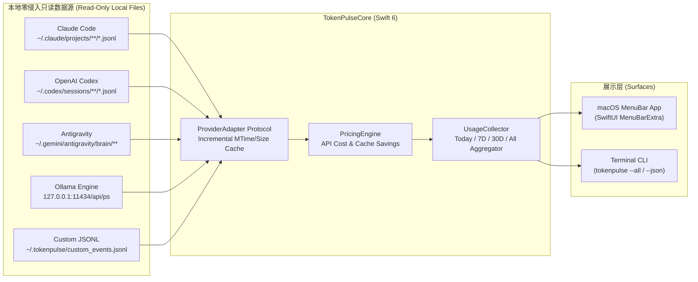

<div align="center">

# ⚡ TokenPulse

**Native macOS Menu Bar & CLI Real-Time AI Token, Prompt Cache & Quota Monitor**  
**原生 macOS 状态栏与终端 AI 产品上下行 Token、缓存命中率及配额实时监控插件**

[](https://github.com/leeeway/TokenPulse)
[](https://swift.org)
[](LICENSE)
[](https://github.com/leeeway/TokenPulse/pulls)

</div>

---

## ✨ Why TokenPulse? / 为什么做这个项目？

重度 AI 开发者每天同时在 Mac 上运行 **Claude Code、OpenAI Codex、Google Antigravity、Cursor、Ollama** 等多个 AI 编程与对话工具，却常常面临三大痛点：
1. **黑盒焦虑**：不知道当前会话实时消耗了多少上下行 Token，也不清楚距离 5 小时 / 7 天 Rate Limit 配额上限还有多远。
2. **上下文膨胀无感知**：Agent 工具 90% 的 Token 来自上下文读取，缺少直观的 **Cache Hit Ratio（缓存命中率）** 监控来判断上下文是否被有效缓存。
3. **订阅回本难量化**：每月支付 $20 / $200 的 Pro/Max 订阅，到底相当于消耗了价值多少美金的官方 API Token？

**TokenPulse** 采用 **100% Local-First（纯本地零隐私泄露、零 HTTPS 证书侵入）** 的混合适配器架构，常驻 macOS 顶部状态栏并提供极客向 `tokenpulse` 终端仪表盘。

---

## 🚀 Key Features / 核心特性

- **📊 状态栏实时跳字 (Menu Bar Live Ticker)**
  - 支持「总 Token + 等效美金 (`⚡ 45.2M · $86.40`)」、「上下行分离 (`↑44.8M ↓412.5K`)」、「仅显示 API 价值」三种状态栏常驻样式。
- **🔌 多 AI 产品零侵入自动采集 (Zero-Config Read-Only Local Adapters)**
  - **Claude Code**：只读解析 `~/.claude/projects/**/*.jsonl`，精确提取 `input_tokens`、`cache_creation_input_tokens`、`cache_read_input_tokens`、`output_tokens`。
  - **OpenAI Codex**：只读解析 `~/.codex/sessions/**/*.jsonl`，提取上下行 Token、推理 Token (`reasoning_output_tokens`)，以及 **5 小时 & 7 天滚动窗口 Rate Limit 百分比配额进度条**。
  - **Google Antigravity / Gemini**：只读解析 `~/.gemini/antigravity/brain/**/.system_generated/logs/transcript.jsonl` 的每步 Planner 上下行与缓存 Token。
  - **Ollama 本地大模型**：只读查询本地 `127.0.0.1:11434/api/ps`，监控正在运行的本地模型与显存占用。
  - **自定义工具扩展 (`~/.tokenpulse/custom_events.jsonl`)**：任何自定义脚本、Hook 或第三方 Agent 只需向本地 JSONL 文件追加一行计数即可纳入统计，**零端口监听、零网络代理**。
- **💰 缓存命中率透视与「白嫖订阅回本」计算器 (Subscription ROI)**
  - 按照 Claude Opus/Sonnet、GPT-5/Codex、Gemini Pro/Flash 官方 API 价格，实时计算 Prompt Cache 帮你省下了多少美金，以及当前周期等效消耗了多少 API 金额，支持一键复制分享卡片。
- **🔥 防爆表熔断预警 (High Burn-Rate Alert)**
  - 当后台 Agent 5 分钟内高频消耗超过阈值时，状态栏图标自动切换为火焰预警并高亮提示。
- **配额重置时间与精简明细（Mac 0.1.1）**
  - 配额进度条下直接显示本地重置日期、时间；到期后显示“待更新”，缺失时明确提示。仅展示日志中的时间，不推算额度已恢复。
  - 状态栏面板按最近活跃时间展示最多 3 个产品，完整总量、CLI 与 JSON 输出仍包含全部产品。
- **刷新可靠性与偏好记忆（Mac 0.1.2）**
  - 快速切换周期时，后台旧结果不会覆盖最新选择；日志扫描与 Ollama 查询并行，先展示日志统计。周期和状态栏样式保存到当前应用的 UserDefaults，重启后恢复，首次使用默认“今日”。
  - 重置时间同时显示剩余时长和本地时刻；到期只提示“待更新”，不推算服务端额度。配额在同一日志文件内按记录时间选择最新值。
  - 原生日志缺失或无效的用量时间仅计入“全部”，不进入日历周期、趋势和实时告警。面板会提示时间未知记录数；自定义 JSONL 的必填字段和编码格式保持兼容。
  - 底栏显示最近扫描时间，标题区区分读取中、LIVE、需检查和超过 30 秒未刷新的状态。悬停可查看默认日志目录的访问问题、时间未知记录和 Ollama 状态；尚未创建的工具目录不当作错误。该检查不代表逐行验证第三方日志。

---

## 🏗️ Architecture / 架构设计



---

## 🔒 Security & Privacy / 安全原理（为什么不需要安装 CA 证书、也不做网络代理？）

很多开发者会好奇：**“TokenPulse 是怎么监控 Claude / Codex / Gemini 的 Token 消耗的？需要安装 CA 根证书抓包或配置本地代理网关吗？会不会有证书或 API Key 泄漏风险？”**

**答案是：完全不需要安装任何 CA 证书，不启动任何代理网关，也不做任何 HTTPS 流量劫持（Zero MITM、Zero Proxy、Zero Port Listener）。**

### 1. 传统「CA 证书抓包/代理网关」vs. TokenPulse「旁路元数据只读解析」

| 对比维度 | ❌ 传统 HTTPS 代理抓包方案 (MITM Proxy / Gateway) | ✅ TokenPulse 零侵入旁路只读架构 |
| :--- | :--- | :--- |
| **工作原理** | 在系统钥匙串安装自签名 **Root CA 根证书**，或将 `ANTHROPIC_BASE_URL` 指向本地代理网关劫持 TLS 流量 | 直接**只读解析**各 AI 客户端在本地磁盘生成的官方会话元数据日志（`.jsonl`）中的数字统计字段 |
| **CA 私钥泄漏风险** | **极高**：本地必须保存 CA 私钥以动态签发证书；一旦私钥被恶意脚本读取，全机所有网站（网银、GitHub、企业内网）HTTPS 均可被静默伪造 | **零风险**：完全不生成、不安装、不接触任何 CA 证书或系统钥匙串（`Keychain`） |
| **本地端口暴露面** | 必须常驻监听代理端口，存在被网页跨站请求（CSRF/CORS）探测的风险 | **零监听端口**：`TokenPulse` 不开启任何 TCP/HTTP 服务端监听端口（`lsof` 零端口占用） |
| **API Key 暴露面** | 代理进程内存中明文流转 `Authorization: Bearer sk-...` 密钥 | **零接触**：本地日志中不含 API Key，TokenPulse 永不触碰任何鉴权凭据 |
| **代码与 Prompt 隐私** | 全量对话正文与源码片段必须经过代理层解密 | **只读数字，不读正文**：解析器仅提取 `input_tokens`、`cache_read_input_tokens`、`output_tokens` 等整型计数器，丢弃对话内容 |
| **网络连接稳定性** | 破坏客户端 Certificate Pinning（证书固定），常导致断连、限流或账号风控 | **100% 原生直连**：AI 客户端与官方服务器保持原生端到端 TLS 加密通信，TokenPulse 仅在旁路读取文件变更 |

### 2. 四重本地安全保障（Defense-in-Depth）
1. **100% 离线与零监听端口**：不开启任何本地 HTTP/TCP 监听服务，没有任何外网请求或遥测上报。
2. **零第三方依赖（Zero Supply-Chain Risk）**：[`Package.swift`](Package.swift) 不引入任何第三方开源库，100% 基于 Apple 官方原生 `Foundation`、`SwiftUI` 构建，彻底杜绝第三方依赖投毒。
3. **严格的权限收敛**：本地自定义事件目录 `~/.tokenpulse` 强制采用 `0700` 权限，数据文件强制采用 `0600`（仅当前系统用户可读写）。
4. **代码极简可审计**：全项目仅 4 个核心源文件（位于 [`Sources/TokenPulseCore/`](Sources/TokenPulseCore)），共约 1,200 行纯 Swift 代码，5 分钟即可完成全量源码白盒审计。

---

## 📦 Quick Start / 快速开始

### 1. 编译打包 macOS 状态栏应用与 CLI

环境要求：**macOS 14.0+**，Xcode Command Line Tools (**Swift 6.0+**)。

```bash
git clone https://github.com/leeeway/TokenPulse.git
cd TokenPulse

# 一键编译 Release 版本并生成 macOS 原生 .app 应用包
chmod +x scripts/build-app.sh
./scripts/build-app.sh

# 启动 macOS 顶部状态栏应用
open dist/TokenPulse.app
```

### 2. 使用终端命令行工具 (`tokenpulse`)

```bash
# 查看近 30 天各 AI 工具上下行 Token 与等效 API 价值面板
./dist/tokenpulse --30d

# 查看全部历史汇总
./dist/tokenpulse --all

# 查看今日实时统计
./dist/tokenpulse --today

# 输出单行状态（适合嵌入 tmux / SketchyBar / BitBar / Raycast）
./dist/tokenpulse --status-bar

# 导出标准 JSON 结构
./dist/tokenpulse --json
```

---

## 🧩 Adding a New Provider Adapter / 贡献新适配器

TokenPulse 采用极简的模块化协议设计。只需实现 `ProviderAdapter` 协议（位于 [`Sources/TokenPulseCore/Adapters.swift`](Sources/TokenPulseCore/Adapters.swift)），不到 50 行代码即可支持一个新的 AI 客户端：

```swift
public protocol ProviderAdapter: Sendable {
    var provider: AIProvider { get }
    func scan() -> AdapterScanResult
}
```

欢迎提交 PR 扩展更多本地 AI 工具（如 Cline、Roo Code、Windsurf、Aider、OpenCode、ChatBox 等）！

---

## 🧪 Running Tests / 运行测试

```bash
swift test
```

---

## 📄 License

This project is licensed under the [MIT License](LICENSE).
