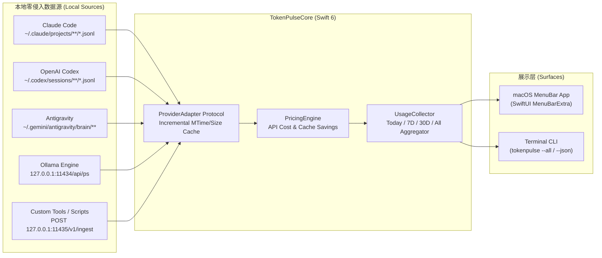

<div align="center">

# ⚡ TokenPulse

**Native macOS Menu Bar & CLI Real-Time AI Token, Prompt Cache & Quota Monitor**  
**原生 macOS 状态栏与终端 AI 产品上下行 Token、缓存命中率及配额实时监控插件**

[](https://github.com/leeeway/TokenPulse)
[](https://swift.org)
[](LICENSE)
[](https://github.com/leeeway/TokenPulse/pulls)

</div>

---

## ✨ Why TokenPulse? / 为什么做这个项目？

重度 AI 开发者每天同时在 Mac 上运行 **Claude Code、OpenAI Codex、Google Antigravity、Cursor、Ollama** 等多个 AI 编程与对话工具，却常常面临三大痛点：
1. **黑盒焦虑**：不知道当前会话实时消耗了多少上下行 Token，也不清楚距离 5 小时 / 7 天 Rate Limit 配额上限还有多远。
2. **上下文膨胀无感知**：Agent 工具 90% 的 Token 来自上下文读取，缺少直观的 **Cache Hit Ratio（缓存命中率）** 监控来判断上下文是否被有效缓存。
3. **订阅回本难量化**：每月支付 $20 / $200 的 Pro/Max 订阅，到底相当于消耗了价值多少美金的官方 API Token？

**TokenPulse** 采用 **100% Local-First（纯本地零隐私泄露、零 HTTPS 证书侵入）** 的混合适配器架构，常驻 macOS 顶部状态栏并提供极客向 `tokenpulse` 终端仪表盘。

---

## 🚀 Key Features / 核心特性

- **📊 状态栏实时跳字 (Menu Bar Live Ticker)**
  - 支持「总 Token + 等效美金 (`⚡ 45.2M · $86.40`)」、「上下行分离 (`↑44.8M ↓412.5K`)」、「仅显示 API 价值」三种状态栏常驻样式。
- **🔌 多 AI 产品零侵入自动采集 (Zero-Config Local Adapters)**
  - **Claude Code**：自动解析 `~/.claude/projects/**/*.jsonl`，精确提取 `input_tokens`、`cache_creation_input_tokens`、`cache_read_input_tokens`、`output_tokens`。
  - **OpenAI Codex**：自动解析 `~/.codex/sessions/**/*.jsonl`，提取上下行 Token、推理 Token (`reasoning_output_tokens`)，以及 **5 小时 & 7 天滚动窗口 Rate Limit 百分比配额进度条**。
  - **Google Antigravity / Gemini**：自动解析 `~/.gemini/antigravity/brain/**/.system_generated/logs/transcript.jsonl` 的每步 Planner 上下行与缓存 Token。
  - **Ollama 本地大模型**：自动轮询 `127.0.0.1:11434/api/ps`，监控正在运行的本地模型与显存占用。
- **🌐 内置轻量级本地网关 (`127.0.0.1:11435`)**
  - 提供 `/v1/ingest` 与 `/v1/stats` 本地接口，任何自定义 Agent、Cursor Hook、Aider、OpenCode 或 Raycast / SketchyBar 脚本均可一键接入。
- **💰 缓存命中率透视与「白嫖订阅回本」计算器 (Subscription ROI)**
  - 按照 Claude Opus/Sonnet、GPT-5/Codex、Gemini Pro/Flash 官方 API 价格，实时计算 Prompt Cache 帮你省下了多少美金，以及当前周期等效消耗了多少 API 金额，支持一键复制分享卡片。
- **🔥 防爆表熔断预警 (High Burn-Rate Alert)**
  - 当后台 Agent 5 分钟内高频消耗超过阈值时，状态栏图标自动切换为火焰预警并高亮提示。

---

## 🏗️ Architecture / 架构设计



---

## 📦 Quick Start / 快速开始

### 1. 编译打包 macOS 状态栏应用与 CLI

环境要求：**macOS 14.0+**，Xcode Command Line Tools (**Swift 6.0+**)。

```bash
git clone https://github.com/leeeway/TokenPulse.git
cd TokenPulse

# 一键编译 Release 版本并生成 macOS 原生 .app 应用包
chmod +x scripts/build-app.sh
./scripts/build-app.sh

# 启动 macOS 顶部状态栏应用
open dist/TokenPulse.app
```

### 2. 使用终端命令行工具 (`tokenpulse`)

```bash
# 查看近 30 天各 AI 工具上下行 Token 与等效 API 价值面板
./dist/tokenpulse --30d

# 查看全部历史汇总
./dist/tokenpulse --all

# 查看今日实时统计
./dist/tokenpulse --today

# 输出单行状态（适合嵌入 tmux / SketchyBar / BitBar）
./dist/tokenpulse --status-bar

# 导出标准 JSON 结构
./dist/tokenpulse --json
```

### 3. 通过本地网关接入任意自定义工具 (`127.0.0.1:11435`)

当 `TokenPulse.app` 运行时，会在本地监听 `127.0.0.1:11435`：

```bash
# 1. 查询实时统计 JSON
curl -s http://127.0.0.1:11435/v1/stats | jq .

# 2. 上报自定义 AI 工具的上下行 Token 消耗
curl -X POST http://127.0.0.1:11435/v1/ingest \
  -H "Content-Type: application/json" \
  -d '{
    "provider": "cursor",
    "model": "claude-sonnet-4-5",
    "session_id": "my-coding-session",
    "input_tokens": 4200,
    "cache_read_tokens": 18500,
    "output_tokens": 680
  }'
```

---

## 🧩 Adding a New Provider Adapter / 贡献新适配器

TokenPulse 采用极简的模块化协议设计。只需实现 `ProviderAdapter` 协议（位于 [`Sources/TokenPulseCore/Adapters.swift`](Sources/TokenPulseCore/Adapters.swift)），不到 50 行代码即可支持一个新的 AI 客户端：

```swift
public protocol ProviderAdapter: Sendable {
    var provider: AIProvider { get }
    func scan() -> AdapterScanResult
}
```

欢迎提交 PR 扩展更多本地 AI 工具（如 Cline、Roo Code、Windsurf、Aider、OpenCode、ChatBox 等）！

---

## 🧪 Running Tests / 运行测试

```bash
swift test
```

---

## 📄 License

This project is licensed under the [MIT License](LICENSE).
