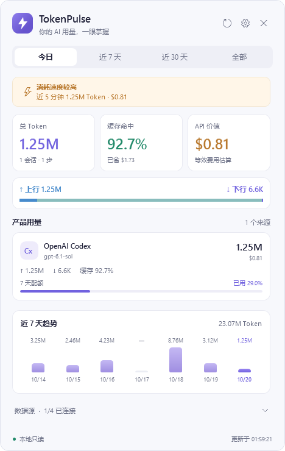
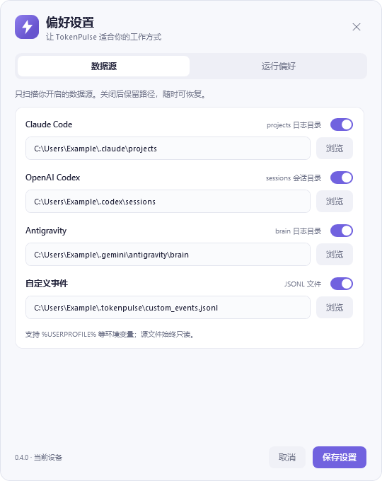
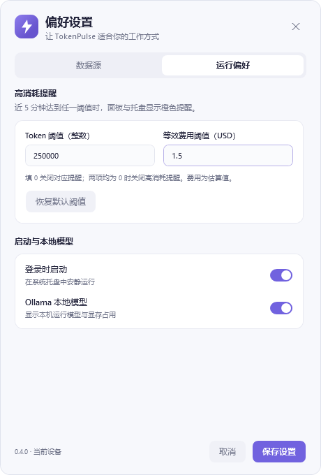

# TokenPulse for Windows

独立的 Windows 托盘应用，使用 C# / WPF / NotifyIcon 和 .NET 10 LTS。Windows 11 x64 是首版验收目标。所有实现、依赖、测试和产物位于本目录；不需要 Swift，也不修改现有 macOS 应用。

## 使用

从 GitHub Actions 的 **Windows Build & Test** 成功运行中下载 `TokenPulse-Windows-x64` 附件，解出其中的 `TokenPulse-Windows-x64.zip`，将整个文件夹解压到固定位置，启动 `TokenPulse.exe`。包含 .NET 运行时，无须另行安装 .NET。首版未签名，不提供自动更新。

**更新时先从旧托盘菜单选择「退出」，再启动新目录中的程序。** 当前版本 `0.4.2`，可在面板底部、托盘悬停提示和安装目录的 `BUILD-INFO.txt` 确认；该文件也记录构建提交。如果仍看到系统标题栏、下拉框和绿色配额条，运行的是旧界面。

- 左键托盘图标打开面板，悬停查看今日 Token 与等效 API 费用。
- 右键菜单提供打开、刷新、设置、退出。关闭窗口继续驻留托盘；退出请使用托盘菜单。
- 面板支持今日、近 7 天、近 30 天、全部；趋势图始终显示近 7 个本地日历日。
- 产品按当前周期最近活跃时间排序，界面最多展示 3 个来源；点击「最近 N 个模型」展开该来源最新 3 个模型的用量与活跃时间。时间未知的记录排在末尾。总量和 CSV 仍包含当前周期全部来源、全部模型，自动刷新保留展开状态。
- 点击「产品用量」右侧导出按钮，将当前显示周期按产品、模型汇总为 CSV。表格采用 UTF-8 BOM，可用 Excel 打开中文；不包含对话内容、日志路径或会话 ID。会话数按模型分别去重，同一会话使用多个模型时，不能把各模型会话数相加当作总会话数。空周期导出只有表头。
- 每 4 秒后台刷新，不重叠扫描；高消耗切换橙色预警图标。默认阈值为近 5 分钟 ≥ 250,000 Token 或 ≥ $1.50，可在「设置 → 运行偏好」修改；某项填 0 则关闭该项提醒，两项都为 0 则关闭高消耗提醒。
- 首次启动显示面板。`--background` 仅启动托盘；重复启动会提示已有实例。
- 在设置中手动启用登录启动，默认关闭。启用后如需搬动程序目录，先关闭该选项，搬动后重新开启。

### 面板与视觉检查

Windows 面板采用紧凑的圆角窗口、分段周期选择、三张用量指标卡和统一的紫色图表。顶部可拖动窗口；右上角关闭按钮隐藏到托盘。数据源详细路径收在面板底部的可展开区域，访问错误会显示摘要。橙色托盘闪电表示消耗速度预警，保持与正常状态一致的图形。

支持顶部最大化/还原按钮、双击标题区域和系统贴靠。宽屏或最大化时内容列居中并限制最大宽高，卡片和图表不会随整块屏幕拉伸；内容超出可用高度时在列内滚动。设置页采用相同约束。

以下为 Windows CI 实际 WPF 渲染图，使用合成数据：







每次 Windows CI 还会生成 `Windows-UI-previews` 附件：使用合成数据直接渲染 WPF 的正常、预警、空数据、窄窗口多来源、数据源详情和设置页，分别导出 100% 与 150% 图像。截图不含真实用户日志。可在 Windows 上手动运行：

```powershell
./dist/TokenPulse-Windows-x64/TokenPulse.exe --visual-test dist/ui-previews
```

渲染检查同时验证周期分段选择、关闭后隐藏及设置开关的构建，不能代替真实多屏与系统托盘交互验收。

## 数据源与设置

| 数据源 | 默认位置 |
| --- | --- |
| Claude Code | `%USERPROFILE%\.claude\projects\**\*.jsonl` |
| Codex | `%USERPROFILE%\.codex\sessions\**\*.jsonl` |
| Antigravity | `%USERPROFILE%\.gemini\antigravity\brain\**\.system_generated\logs\transcript.jsonl` |
| 自定义事件 | `%USERPROFILE%\.tokenpulse\custom_events.jsonl` |
| Ollama | `http://127.0.0.1:11434/api/ps` |

这些是初始查找路径，不保证每个客户端或版本都使用相同位置。可在设置中浏览或指定完整路径，支持展开 `%USERPROFILE%` 等环境变量。路径可以暂不存在；缺失与访问失败会分别显示。首版不自动发现 WSL，也不主动启动 WSL。目录内的符号链接与 junction 不跟随，以避免循环或重复扫描。

「设置 → 数据源」提供 Claude Code、Codex、Antigravity、自定义事件的独立开关。关闭后保留路径，不再访问该来源，清除其扫描缓存；总量、趋势、模型明细和导出只统计开启来源。再次开启会重新读取已有历史，不会删除原日志。开关按日志来源生效：例如自定义文件中的 Codex 事件受“自定义事件”开关控制。所有日志源关闭时，面板显示明确的关闭状态，并提供重新设置入口。

旧版设置自动补充默认值，四个日志源继续开启，提醒阈值保持不变。关闭的数据源允许保留空路径；重新开启时必须填写有效的绝对路径。设置页切换分组不会丢失未保存的编辑，点击「保存设置」才生效；「恢复默认阈值」只恢复两个提醒数值，不影响路径和开关。Token 阈值填写非负整数，费用使用系统的小数格式，且必须是有限的非负数。

设置保存到 `%LOCALAPPDATA%\TokenPulse\settings.json`。开机启动仅使用当前用户的 `HKCU\Software\Microsoft\Windows\CurrentVersion\Run\TokenPulseWindows`，无须管理员权限。损坏的设置文件不会被自动覆盖，会显示错误并临时使用默认设置。

应用只读源日志；不创建代理、不监听端口、不读取凭据、不上传数据。解析 JSONL 时会读取包含对话的日志行，但只保留统计字段，不记录或展示对话内容。仅在启用 Ollama 时访问固定 loopback 地址，不使用系统代理、不跟随重定向。Ollama 只显示运行模型与显存，不据此推算 Token。

配额仅来自日志的已有记录，进度条下直接显示本地重置日期和时间；悬停可查看配额记录时间和完整重置时间。旧日志不代表实时服务端额度。超过记录中的重置时间后显示「已到重置时间 · 待更新」及「上次重置」时间，旧进度条淡化，不会自行推算额度已归零。缺失时间时明确显示「日志未提供重置时间」。费用规则复制当前 Mac 实现，仅为兼容估算，不是最新官方报价。推理 Token 单独展示但不再次加到输出总数。

从 0.4.1 起，原生日志中缺失或无效的用量时间标记为「时间未知」，仅计入「全部」及其模型明细和导出，不参与今日、7 天、30 天、趋势与高消耗提醒。文件修改时间不再决定这些记录的统计归属，追加或重启不会将旧记录变成刚刚发生的消耗。自定义事件仍要求有效时间戳。

数据源详情显示读取文件数与有效用量记录数；JSON 损坏行跳过并显示黄色检查提示。仅末行内容是合法但不完整的 JSON 对象前缀时，显示「疑似未写完，等待追加」，下次文件变化重新判断。无关的合法 JSON 记录不算损坏，也不算用量。该检查报告 JSON 语法问题，不代表验证了第三方所有事件字段。

### 自定义 JSONL

兼容 Swift `TokenUsageEvent` 的 camelCase 字段，每行一个 JSON 对象，时间使用 ISO 8601；以下字段均必填，费用和缓存节省采用事件中给出的数值：

```json
{"id":"custom-1","provider":"custom","model":"my-model","timestamp":"2026-10-18T10:00:00Z","sessionId":"s1","inputTokens":100,"cacheWriteTokens":20,"cacheReadTokens":80,"outputTokens":50,"reasoningTokens":10,"costUSD":0.123,"savedByCacheUSD":0.045}
```

`provider` 可为 `claude_code`、`codex`、`antigravity`、`cursor`、`ollama`、`custom`。计数和费用应非负。无效行和未完成的末行跳过，文件变化后重新解析。不要同时把同一使用记录写入原始日志与自定义文件，应用不会跨数据源去重。

## 开发与打包

安装 .NET 10 SDK，在本目录执行：

```powershell
# 无第三方测试框架依赖；任一测试失败会返回非零状态
dotnet run --project TokenPulse.Tests/TokenPulse.Tests.csproj -c Release

# Windows 上运行界面
dotnet run --project TokenPulse.Windows/TokenPulse.Windows.csproj

# 自带运行时的 x64 ZIP，输出到 windows/dist/
./scripts/build.ps1
```

核心和测试目标为 `net10.0`，可以在 macOS/Linux 运行。WPF 目标为 `net10.0-windows`，可交叉编译，运行和托盘交互验收必须在 Windows 完成。运行测试应使用上面的 `dotnet run`，而非 `dotnet test`。

`TokenPulse.Core` 包含解析、价格、聚合、只读扫描、设置存储和 Ollama 客户端；`TokenPulse.Windows` 包含 UI、托盘和 Windows 登录启动。文件缓存按规范路径、修改时间和长度失效；变化文件全量重读以正确计算 Codex 累计差分。扫描时正在变化的文件不缓存，下一轮重试。大日志首次扫描会较慢，运行于后台线程。

统计汇总同样在后台执行：一次事件遍历同时累积总量、产品、模型、每日趋势与近期消耗，切换周期会取消旧任务，防止过期计算覆盖新选择。无变化的产品卡片保留控件，避免每 4 秒刷新打断键盘焦点；配额到期仍会触发更新。

`TokenPulse.Tests/Fixtures` 的前三份样例独立复制自现有 Swift 测试，不移动、不修改原测试。Windows CI 独立触发，执行核心测试、发布和 WPF/托盘启动冒烟测试，再上传 ZIP；不会更改 Mac 的构建或发布。

## Windows 11 手动验收

- 启动后检查托盘、悬停摘要、左键面板、右键刷新/设置/退出；关闭面板仍刷新，重复启动不产生第二个实例。
- 使用测试日志验证四种统计周期、缓存与费用、配额记录、趋势及预警；切换面板周期不改变托盘的今日摘要。
- 展开模型后等待刷新，确认展开状态保留；快速切换周期，确认最终显示所选周期。导出 CSV 后用 Excel 检查中文、数值与周期；取消保存、选择不可写位置时不应留下半成品或损坏已有文件。
- 使用中文/空格路径；追加、截断、删除、重建日志；模拟访问拒绝、末行写到一半，观察状态恢复且刷新不重复计数。
- 修改路径并重启，确认设置持久化；启用/关闭登录启动并实际注销登录验证；退出后移除托盘图标。
- 逐一关闭/开启日志源，检查对应统计移除与恢复；全部关闭时不显示缺失或访问失败。调整提醒阈值，确认面板与托盘一致，0 可分别关闭提醒；切换设置分组后未保存内容仍在，取消不会写入配置。
- 在 100%、150%、200% 缩放以及混合 DPI 多屏之间打开面板，确认窗口可见、内容可滚动、按钮可操作。
- 在任务管理器重启 Windows Explorer，确认托盘图标恢复；锁屏/解锁、睡眠恢复后确认继续刷新。
- 启停 Ollama，确认旧运行模型被清空；系统代理不影响 loopback 查询。

CI 冒烟测试不替代上述桌面交互验收。未经真实 Windows 验证的项目应保留为待验收，不能仅凭交叉编译视为通过。
